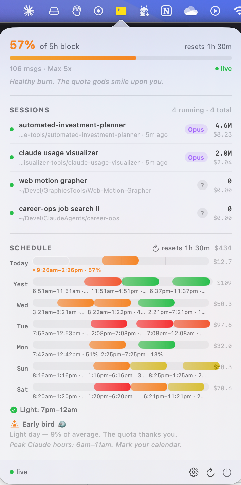

# Claude Usage Visualizer

A macOS menu bar app that tracks your Claude Code usage against Max plan limits in real time.

Lives in your menu bar, color-codes itself by burn rate, and shows a popover with per-session usage, a 7-day block schedule, and an at-a-glance utilization gauge.

<p align="center">
  
</p>

## Features

- **Menu bar icon** that tints green / yellow / orange / red based on burn rate and 5-hour block utilization.
- **Per-session breakdown**: tokens, cost, dominant model, and "time since last message" for every active Claude Code session.
- **5-hour block tracking**: current block, time remaining, message count, and a visual schedule of recent blocks across the last 7 days.
- **Live utilization** from Anthropic's OAuth usage endpoint (the same numbers as the `/usage` slash command).
- **Burn-rate gauge** with configurable warm / hot / critical thresholds.
- **Behavioral profile** that surfaces patterns in your usage history.

## Requirements

- macOS 14.0+ (Sonoma or later)
- [Claude Code](https://claude.com/claude-code) CLI installed and signed in (so `~/.claude/` exists with valid credentials)
- Xcode 26.0+ to build from source
- [xcodegen](https://github.com/yonaskolb/XcodeGen) (`brew install xcodegen`)

## Build & run

```bash
xcodegen generate
xcodebuild -scheme ClaudeUsageVisualizer -configuration Release build
```

Or open `ClaudeUsageVisualizer.xcodeproj` in Xcode and hit Run.

The app reads Claude Code's token through Apple's `/usr/bin/security` tool, which the keychain item already trusts, so there is no keychain password prompt on first launch or after Claude Code rotates the token. Only if that read returns nothing does the manual refresh button fall back to a direct keychain read, which can show the standard macOS dialog.

## How it works

- A `TranscriptWatcher` actor uses FSEvents to watch `~/.claude/projects/**/*.jsonl` and parses incremental token-count deltas.
- A `SessionRegistry` actor polls `~/.claude/sessions/*.json` and uses `kill(pid, 0)` to detect which sessions are alive.
- A `UsageAggregator` actor maintains a 7-day ring buffer, reconstructs 5-hour blocks anchored on the first assistant turn, and computes a burn rate over the last 5 minutes.
- An `OAuthUsageClient` actor reads the Claude Code OAuth bearer token from the macOS keychain and polls `https://api.anthropic.com/api/oauth/usage` with a 6-minute TTL and exponential backoff on 429s.

See [`ARCHITECTURE.md`](./ARCHITECTURE.md) for the full design.

## Privacy & security

- **The app is not sandboxed.** This is required to read `~/.claude/` and the keychain. The non-sandbox entitlement is documented in `ARCHITECTURE.md`.
- **Reads your Claude Code OAuth token from the macOS keychain** by running Apple's `/usr/bin/security find-generic-password` and reading its output in-process. Claude Code files the item with that same tool, so it is already on the item's access list and no dialog appears. The token is never logged or put on a command line. Background polls never call `SecItemCopyMatching`, because old-style login-keychain items ignore the "no interaction" flag and would show the password dialog.
- **The token never leaves your machine** except as a `Bearer` header on TLS requests to `https://api.anthropic.com/api/oauth/usage` — the same endpoint Claude Code itself uses for its `/usage` command.
- **No prompt or response content is read** from the JSONL transcripts. Only metadata: `sessionId`, `cwd`, `model`, `requestId`, and token counts.
- **No analytics, telemetry, or third-party network calls.**

## Disclaimer

This tool relies on `/api/oauth/usage`, an **unofficial** endpoint intended for first-party Claude Code use. Anthropic may change, rate-limit, or restrict this endpoint at any time. The `OAuthUsageClient` already implements caching and 429 backoff, but expect occasional drift between this widget and the official `/usage` command.

Review the [Claude Terms of Service](https://www.anthropic.com/legal/consumer-terms) before redistributing prebuilt binaries.

This is a personal project, not affiliated with or endorsed by Anthropic.

## License

[MIT](./LICENSE) — free to use, modify, and distribute. No warranty.
